# Responsive Design and Mobile-First Approach

<cite>
**Referenced Files in This Document**
- [Pujo_Sahayak_Master_Project_Context.md](file://Pujo_Sahayak_Master_Project_Context.md)
- [tasks/plan.md](file://tasks/plan.md)
- [tasks/todo.md](file://tasks/todo.md)
</cite>

## Table of Contents
1. [Introduction](#introduction)
2. [Project Structure](#project-structure)
3. [Core Components](#core-components)
4. [Architecture Overview](#architecture-overview)
5. [Detailed Component Analysis](#detailed-component-analysis)
6. [Dependency Analysis](#dependency-analysis)
7. [Performance Considerations](#performance-considerations)
8. [Troubleshooting Guide](#troubleshooting-guide)
9. [Conclusion](#conclusion)

## Introduction

This document defines the responsive design system and mobile-first approach for Puja Sahayak, a React + Vite PWA built around Durga Puja discovery, AI assistance, route planning, social meetups, safety, and local exploration across Kolkata. It translates the product’s mobile-first philosophy into concrete breakpoints, navigation patterns, grid/layout behavior, touch interaction guidelines, performance strategies, cross-browser considerations, and testing approaches.

The app is designed to feel like a digital companion for exploring Kolkata during Puja while remaining useful beyond the festival through restaurants, events, and local experiences. Navigation is intentionally simple and mobile-first, with five primary tabs: Home, Favorites, Search, Categories, and Meets. The AI assistant (Maya) is accessible prominently without occupying a permanent tab slot.

**Section sources**
- [Pujo_Sahayak_Master_Project_Context.md:1-18](file://Pujo_Sahayak_Master_Project_Context.md#L1-L18)
- [Pujo_Sahayak_Master_Project_Context.md:140-158](file://Pujo_Sahayak_Master_Project_Context.md#L140-L158)

## Project Structure

At a high level, the application follows a mobile-first screen-driven structure with routes mapped to core user journeys such as discovery, exploration, planning, social connection, and utility access. The implementation plan specifies 21 mockup screens including Splash, Home, Explore/Pandal Directory, Pandal Detail, Maya (chat/scan/voice), Puja Planner, Meets, Categories, Search, Profile, Safety/Emergency, Missing Person Report, Trip/Route Map, Restaurant Detail, Create Meetup, Settings, and Beyond Puja.

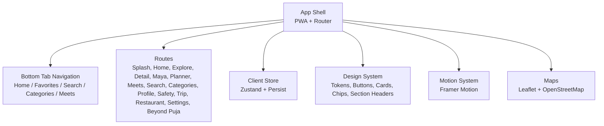

**Diagram sources**
- [tasks/plan.md:1-18](file://tasks/plan.md#L1-L18)
- [tasks/plan.md:19-39](file://tasks/plan.md#L19-L39)

**Section sources**
- [tasks/plan.md:1-18](file://tasks/plan.md#L1-L18)
- [tasks/plan.md:19-39](file://tasks/plan.md#L19-L39)

## Core Components

### Breakpoint Strategy

The responsive strategy should align with common mobile, tablet, and desktop ranges while honoring the app’s mobile-first nature:

- Mobile: less than 768px
- Tablet: 768px to 1024px
- Desktop: greater than 1024px

These breakpoints should be applied consistently across layout grids, navigation transitions, content density, and component sizing. On mobile, prioritize single-column layouts, bottom navigation, and compact cards. On tablet, introduce two-column grids where appropriate and consider expanding horizontal rails. On desktop, constrain the app width and enable multi-column rails and richer detail views.

Recommended breakpoint usage:

| Screen Size | Layout Behavior | Navigation | Content Density |
|---|---|---|---|
| Mobile (<768px) | Single column, full-width cards | Bottom tab navigation | Compact spacing, smaller typography |
| Tablet (768px–1024px) | Two-column grids, expanded rails | Bottom tab navigation or top bar depending on orientation | Moderate spacing, larger cards |
| Desktop (>1024px) | Constrained app frame, multi-column rails | Sidebar navigation recommended for desktop | Spacious layout, richer detail panels |

**Section sources**
- [tasks/plan.md:60-62](file://tasks/plan.md#L60-L62)
- [tasks/todo.md:74-75](file://tasks/todo.md#L74-L75)

### Adaptive Navigation Patterns

The primary navigation is defined as five tabs: Home, Favorites, Search, Categories, and Meets. On mobile, this maps directly to bottom tab navigation. On desktop, the navigation should transition to a sidebar pattern that preserves the same information architecture while making better use of horizontal space.

Key rules:

- Keep the five-tab structure consistent across devices.
- Do not add extra permanent tabs unless explicitly required by later design decisions.
- Maya should remain prominently accessible without consuming one of the five permanent navigation slots.
- On desktop, consider a left sidebar with icons and labels, while preserving bottom navigation on mobile.
- Deep links and nested routes should work regardless of navigation mode.

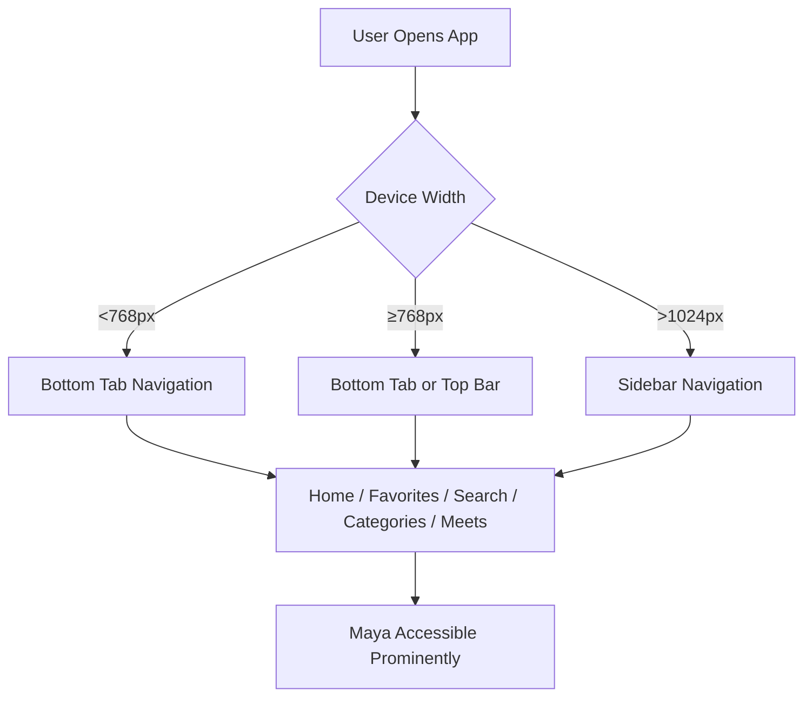

**Diagram sources**
- [Pujo_Sahayak_Master_Project_Context.md:140-158](file://Pujo_Sahayak_Master_Project_Context.md#L140-L158)
- [tasks/plan.md:19-39](file://tasks/plan.md#L19-L39)

**Section sources**
- [Pujo_Sahayak_Master_Project_Context.md:140-158](file://Pujo_Sahayak_Master_Project_Context.md#L140-L158)
- [tasks/plan.md:19-39](file://tasks/plan.md#L19-L39)

### Grid System and Layout Components

The layout should be built from a flexible grid that adapts from single-column mobile layouts to multi-column desktop layouts. Shared components include buttons, chips, cards, section headers, and page-transition wrappers. Place cards, offer cards, event cards, and meetup cards should scale gracefully across breakpoints.

Guidelines:

- Use a base grid of 4 columns on mobile, 6–8 columns on tablet, and 12 columns on desktop.
- Cards should span full width on mobile, half or third columns on tablet, and quarter or sixth columns on desktop.
- Horizontal rails (restaurants, offers, events, trending pandals) should scroll horizontally on mobile and expand into multi-column grids on desktop.
- Detail pages should stack vertically on mobile and split into hero + side panel on desktop where appropriate.
- The app shell should constrain maximum width on desktop to maintain readability and visual hierarchy.

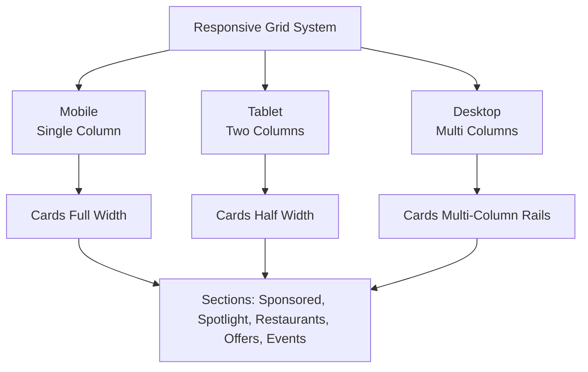

**Diagram sources**
- [tasks/todo.md:10-11](file://tasks/todo.md#L10-L11)
- [Pujo_Sahayak_Master_Project_Context.md:168-284](file://Pujo_Sahayak_Master_Project_Context.md#L168-L284)

**Section sources**
- [tasks/todo.md:10-11](file://tasks/todo.md#L10-L11)
- [Pujo_Sahayak_Master_Project_Context.md:168-284](file://Pujo_Sahayak_Master_Project_Context.md#L168-L284)

### Touch Interaction Guidelines

Because Puja Sahayak is mobile-first, touch interactions must be intentional and ergonomic:

- Tap targets should be at least 44x44 pixels where possible.
- Primary actions such as Save, Visited, Route, Join, and Call should be clearly separated and easy to tap.
- Swipe gestures should support horizontal scrolling for rails and list navigation where appropriate.
- Long press can be used for secondary actions such as saving or sharing, but never as the only way to perform critical tasks.
- Camera interactions for Maya Scan should provide clear feedback, gallery controls, flash toggle, and permission handling.
- Voice input should have a visible waveform indicator and clear start/stop states.
- Reduced-motion preferences should be respected throughout animations and transitions.

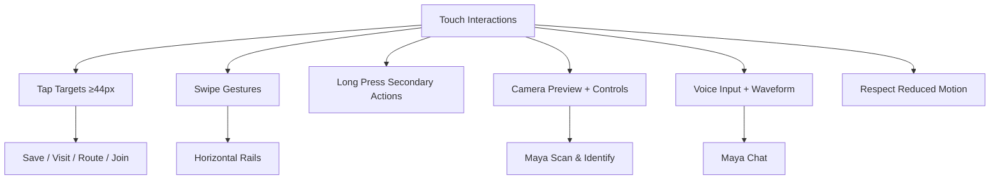

**Diagram sources**
- [tasks/todo.md:36-40](file://tasks/todo.md#L36-L40)
- [tasks/plan.md:13-15](file://tasks/plan.md#L13-L15)

**Section sources**
- [tasks/todo.md:36-40](file://tasks/todo.md#L36-L40)
- [tasks/plan.md:13-15](file://tasks/plan.md#L13-L15)

### Mobile-Specific UX Patterns

Several features are especially important on mobile:

- Continue Where You Left Off helps users resume exploration, search, route planning, or category browsing without starting over.
- Bottom navigation provides quick access to the five primary sections.
- Floating action buttons can surface Maya voice input or camera scan without cluttering the main interface.
- Location-aware content should prioritize nearby places, transport options, and emergency services.
- Offline-capable shells should allow basic navigation even when network connectivity is limited.

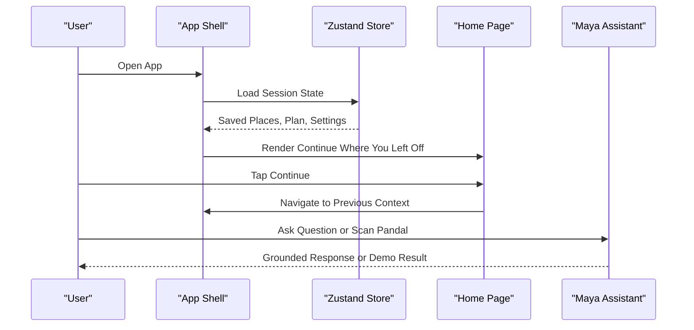

**Diagram sources**
- [Pujo_Sahayak_Master_Project_Context.md:286-318](file://Pujo_Sahayak_Master_Project_Context.md#L286-L318)
- [tasks/plan.md:12-15](file://tasks/plan.md#L12-L15)

**Section sources**
- [Pujo_Sahayak_Master_Project_Context.md:286-318](file://Pujo_Sahayak_Master_Project_Context.md#L286-L318)
- [tasks/plan.md:12-15](file://tasks/plan.md#L12-L15)

## Architecture Overview

The responsive architecture combines a mobile-first UI layer with a client store, routing, motion system, and mapping integration. Tailwind CSS v4 encodes the design tokens, while Framer Motion handles transitions and respects reduced-motion settings. Leaflet with OpenStreetMap tiles supports route visualization without requiring external API keys.

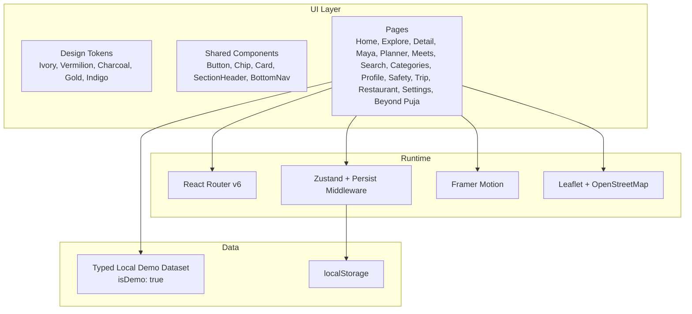

**Diagram sources**
- [tasks/plan.md:7-18](file://tasks/plan.md#L7-L18)
- [tasks/plan.md:19-39](file://tasks/plan.md#L19-L39)

**Section sources**
- [tasks/plan.md:7-18](file://tasks/plan.md#L7-L18)
- [tasks/plan.md:19-39](file://tasks/plan.md#L19-L39)

## Detailed Component Analysis

### Breakpoints and Responsive Rules

Breakpoints should be implemented as reusable tokens or theme values rather than hard-coded pixel checks scattered across components. Recommended rules:

- Mobile (<768px): single-column layout, bottom navigation, compact cards, horizontal rails.
- Tablet (768px–1024px): two-column grids, expanded rails, optional top navigation.
- Desktop (>1024px): constrained app frame, sidebar navigation, multi-column rails, richer detail panels.

Components should query these breakpoints through the design system so that changes propagate consistently.

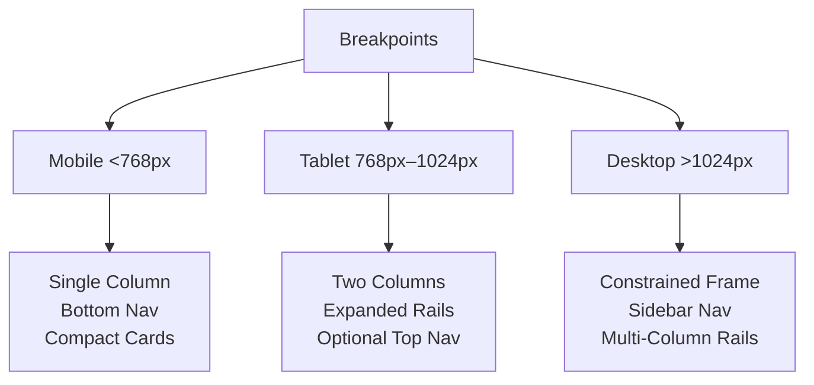

**Diagram sources**
- [tasks/plan.md:60-62](file://tasks/plan.md#L60-L62)
- [tasks/todo.md:74-75](file://tasks/todo.md#L74-L75)

**Section sources**
- [tasks/plan.md:60-62](file://tasks/plan.md#L60-L62)
- [tasks/todo.md:74-75](file://tasks/todo.md#L74-L75)

### Navigation Transition Flow

The transition from bottom tab navigation on mobile to sidebar navigation on desktop should preserve the same routes and state. Users should not lose context when switching between device types or orientations.

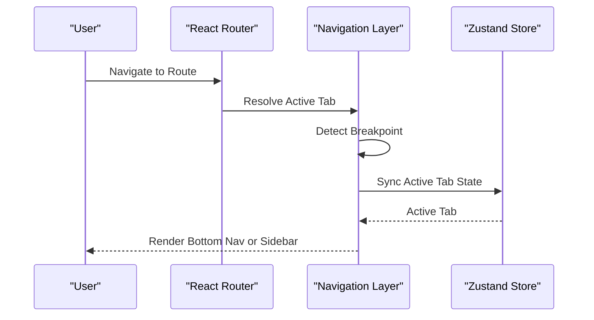

**Diagram sources**
- [tasks/plan.md:11-12](file://tasks/plan.md#L11-L12)
- [tasks/plan.md:19-39](file://tasks/plan.md#L19-L39)

**Section sources**
- [tasks/plan.md:11-12](file://tasks/plan.md#L11-L12)
- [tasks/plan.md:19-39](file://tasks/plan.md#L19-L39)

### Grid and Layout Adaptation

Layout components should adapt based on screen size while keeping content hierarchy intact. For example, the Home page includes sponsored content, explore spotlight, restaurants, offers, events, and continue-where-left-off sections. These should render as stacked sections on mobile and as multi-column rails on desktop.

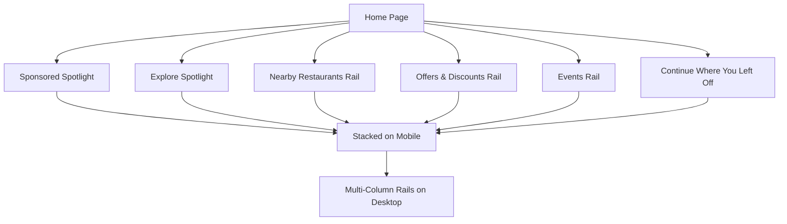

**Diagram sources**
- [Pujo_Sahayak_Master_Project_Context.md:168-284](file://Pujo_Sahayak_Master_Project_Context.md#L168-L284)

**Section sources**
- [Pujo_Sahayak_Master_Project_Context.md:168-284](file://Pujo_Sahayak_Master_Project_Context.md#L168-L284)

### Touch Interaction Flow

Touch interactions should be predictable and safe, especially for location-based and time-sensitive features such as route planning and emergency shortcuts.

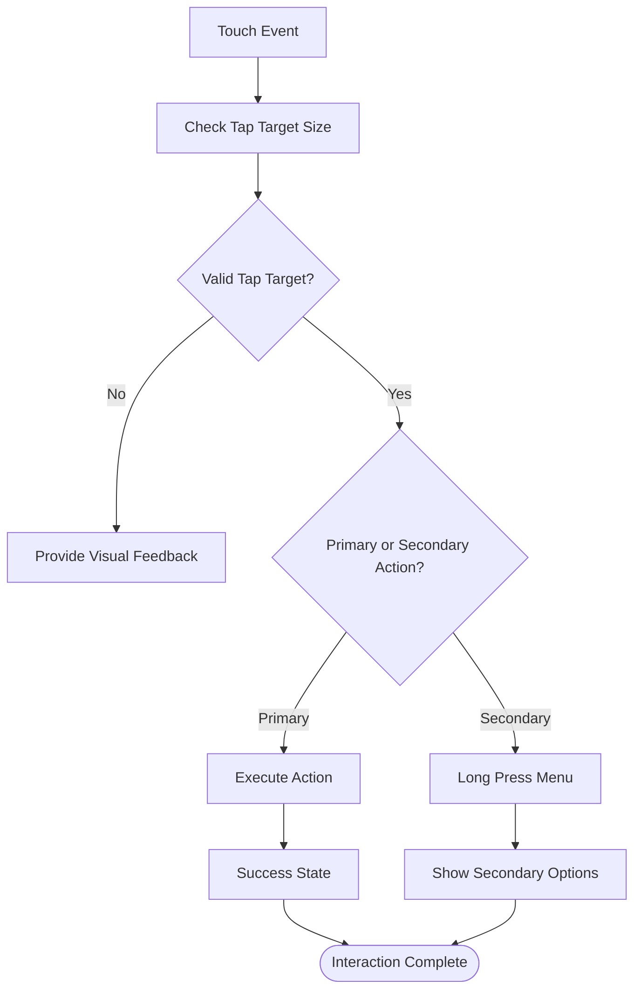

**Diagram sources**
- [tasks/todo.md:36-40](file://tasks/todo.md#L36-L40)

**Section sources**
- [tasks/todo.md:36-40](file://tasks/todo.md#L36-L40)

### Maya Interaction Flow

Maya should be grounded in the local dataset and avoid hallucination. On mobile, it should be accessible via chat, voice, and camera scan. On desktop, it should remain prominent but not consume a permanent navigation slot.

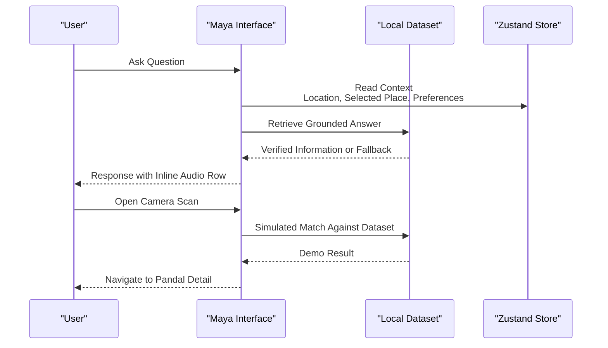

**Diagram sources**
- [Pujo_Sahayak_Master_Project_Context.md:558-662](file://Pujo_Sahayak_Master_Project_Context.md#L558-L662)
- [tasks/todo.md:36-40](file://tasks/todo.md#L36-L40)

**Section sources**
- [Pujo_Sahayak_Master_Project_Context.md:558-662](file://Pujo_Sahayak_Master_Project_Context.md#L558-L662)
- [tasks/todo.md:36-40](file://tasks/todo.md#L36-L40)

## Dependency Analysis

The responsive system depends on several layers:

- Design tokens define colors, radii, type scale, and Bengali serif accents.
- Shared components depend on tokens and are reused across pages.
- Pages depend on routing, store, motion, and maps.
- The store persists user state to localStorage.
- The dataset is marked as demo data and should not present simulated results as production facts.

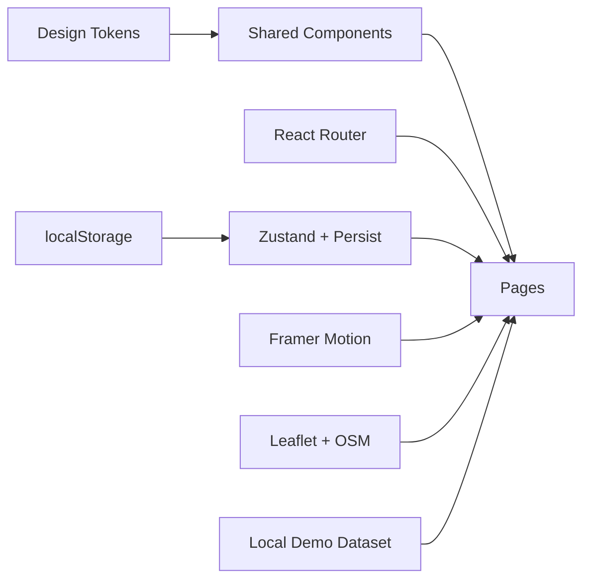

**Diagram sources**
- [tasks/plan.md:7-18](file://tasks/plan.md#L7-L18)
- [tasks/plan.md:19-39](file://tasks/plan.md#L19-L39)

**Section sources**
- [tasks/plan.md:7-18](file://tasks/plan.md#L7-L18)
- [tasks/plan.md:19-39](file://tasks/plan.md#L19-L39)

## Performance Considerations

Performance optimization for mobile devices should focus on fast initial load, efficient rendering, and responsible media handling:

- Use PWA capabilities for installability and offline shell caching.
- Prefer lightweight images or gradients where placeholders are sufficient; ensure layout does not break without images.
- Lazy-load heavy components such as maps and camera interfaces.
- Avoid unnecessary re-renders by keeping store state minimal and localized.
- Respect reduced-motion preferences to improve accessibility and reduce CPU usage.
- Keep bundle sizes reasonable by splitting routes and avoiding large dependencies on mobile.
- Test Lighthouse PWA metrics and ensure the app remains usable under low connectivity.

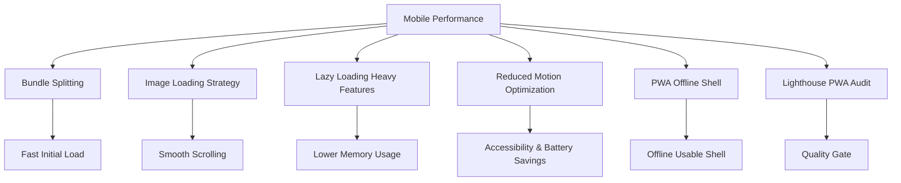

**Diagram sources**
- [tasks/plan.md:9-10](file://tasks/plan.md#L9-L10)
- [tasks/plan.md:13-17](file://tasks/plan.md#L13-L17)
- [tasks/todo.md:74-75](file://tasks/todo.md#L74-L75)

**Section sources**
- [tasks/plan.md:9-10](file://tasks/plan.md#L9-L10)
- [tasks/plan.md:13-17](file://tasks/plan.md#L13-L17)
- [tasks/todo.md:74-75](file://tasks/todo.md#L74-L75)

## Troubleshooting Guide

Common responsive and mobile-related issues and their mitigation strategies:

- Navigation mismatch: Ensure bottom tabs map correctly to routes and sidebar navigation mirrors the same structure on desktop.
- Broken layouts on small screens: Verify single-column fallbacks and avoid fixed widths on cards and rails.
- Touch target too small: Increase tap targets for primary actions and avoid relying solely on long press.
- Camera permissions failing: Provide clear permission prompts and graceful fallbacks when getUserMedia is unavailable.
- Animations causing lag: Honor reduced-motion settings and avoid heavy animations on low-end devices.
- Offline behavior: Confirm that the PWA shell loads and that non-critical features degrade gracefully.
- Bengali text rendering: Ensure fonts load correctly and system fallbacks are available.

**Section sources**
- [tasks/plan.md:13-17](file://tasks/plan.md#L13-L17)
- [tasks/todo.md:36-40](file://tasks/todo.md#L36-L40)
- [tasks/todo.md:74-75](file://tasks/todo.md#L74-L75)

## Conclusion

Puja Sahayak’s responsive design system should be mobile-first, with clear breakpoints, adaptive navigation, flexible grids, thoughtful touch interactions, and strong performance practices. The five-tab navigation should remain simple on mobile and evolve into a sidebar on desktop. Maya should be accessible and grounded, while the app remains useful offline and across browsers. Testing should cover multiple devices, orientations, and connectivity conditions, with Lighthouse and manual reviews ensuring quality.

[No sources needed since this section summarizes without analyzing specific files]