# UI/UX Design System

<cite>
**Referenced Files in This Document**
- [Pujo_Sahayak_Master_Project_Context.md](file://Pujo_Sahayak_Master_Project_Context.md)
- [tasks/plan.md](file://tasks/plan.md)
- [tasks/todo.md](file://tasks/todo.md)
</cite>

## Table of Contents
1. [Introduction](#introduction)
2. [Project Structure](#project-structure)
3. [Core Components](#core-components)
4. [Architecture Overview](#architecture-overview)
5. [Detailed Component Analysis](#detailed-component-analysis)
6. [Dependency Analysis](#dependency-analysis)
7. [Performance Considerations](#performance-considerations)
8. [Troubleshooting Guide](#troubleshooting-guide)
9. [Conclusion](#conclusion)
10. [Appendices](#appendices)

## Introduction
This document defines the UI/UX design system for Puja Sahayak, a mobile-first web application and PWA that helps users discover, understand, plan, visit, and share experiences around Durga Puja and broader local exploration in Kolkata. The design system is grounded in a clear product philosophy: a continuous user journey from discovery to community, with an AI assistant named Maya as a contextual guide rather than a generic chatbot.

The project uses React 18, TypeScript, Vite, Tailwind CSS v4, React Router v6, Zustand, Framer Motion, Leaflet, and OpenStreetMap tiles. The visual identity is bespoke and not based on a generic component library. The design tokens include ivory surfaces, vermilion primary, charcoal ink, muted gold, and dark imagery. Bengali typography uses Noto Serif Bengali and Hind Sildar with system fallbacks.

The navigation structure is intentionally simple and mobile-first, with five permanent tabs: Home, Favorites, Search, Categories, and Meets. The AI assistant Maya is accessible prominently but does not occupy one of these five slots.

**Section sources**
- [Pujo_Sahayak_Master_Project_Context.md:1-20](file://Pujo_Sahayak_Master_Project_Context.md#L1-L20)
- [Pujo_Sahayak_Master_Project_Context.md:21-43](file://Pujo_Sahayak_Master_Project_Context.md#L21-L43)
- [Pujo_Sahayak_Master_Project_Context.md:140-157](file://Pujo_Sahayak_Master_Project_Context.md#L140-L157)
- [tasks/plan.md:1-18](file://tasks/plan.md#L1-L18)

## Project Structure
At this stage, the repository contains the master product context and implementation planning documents. There are no source code files present yet; the project is in a pre-implementation phase where the design system, routes, screens, and tasks are defined before coding begins.

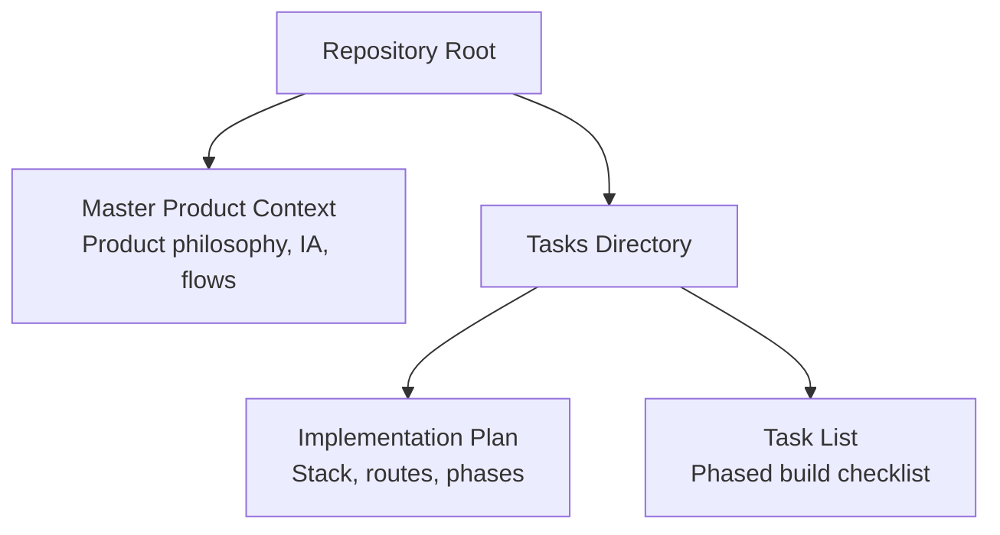

**Diagram sources**
- [Pujo_Sahayak_Master_Project_Context.md:1-20](file://Pujo_Sahayak_Master_Project_Context.md#L1-L20)
- [tasks/plan.md:1-18](file://tasks/plan.md#L1-L18)
- [tasks/todo.md:1-16](file://tasks/todo.md#L1-L16)

**Section sources**
- [Pujo_Sahayak_Master_Project_Context.md:1-20](file://Pujo_Sahayak_Master_Project_Context.md#L1-L20)
- [tasks/plan.md:1-18](file://tasks/plan.md#L1-L18)
- [tasks/todo.md:1-16](file://tasks/todo.md#L1-L16)

## Core Components
The design system is described through reusable UI elements and shared patterns rather than a third-party component library. The planned components include:

- Button
- Chip
- Card, including a place-card variant
- SectionHeader
- BottomNav with five tabs and active state
- AppShell
- Waveform for voice input feedback
- ScanFrame for camera scanning animation
- Page-transition wrapper with reduced-motion support

These components are intended to be built with Tailwind CSS v4 design tokens, ensuring consistent spacing, color, radius, and typography across screens.

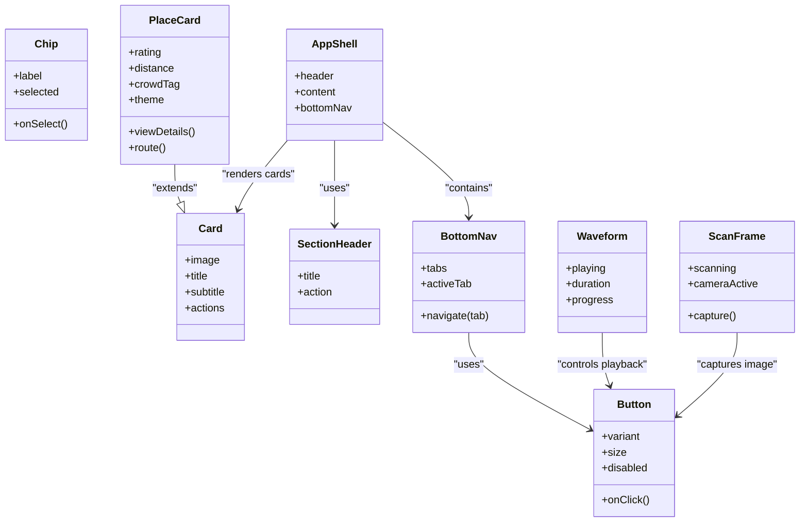

**Diagram sources**
- [tasks/todo.md:10-12](file://tasks/todo.md#L10-L12)
- [tasks/plan.md:9-15](file://tasks/plan.md#L9-L15)

**Section sources**
- [tasks/todo.md:10-12](file://tasks/todo.md#L10-L12)
- [tasks/plan.md:9-15](file://tasks/plan.md#L9-L15)

## Architecture Overview
The application architecture centers on a mobile-first PWA shell with a bottom navigation bar mapping to five core routes. Detail pages use nested routing. State is managed by Zustand with persistence, and motion is handled by Framer Motion while respecting reduced-motion preferences. Maps use Leaflet with OpenStreetMap tiles.

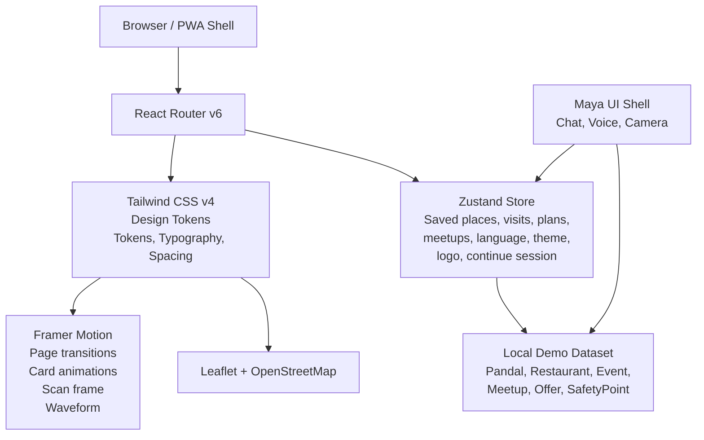

**Diagram sources**
- [tasks/plan.md:9-18](file://tasks/plan.md#L9-L18)
- [tasks/todo.md:10-14](file://tasks/todo.md#L10-L14)

**Section sources**
- [tasks/plan.md:9-18](file://tasks/plan.md#L9-L18)
- [tasks/todo.md:10-14](file://tasks/todo.md#L10-L14)

## Detailed Component Analysis

### Primary Navigation Structure
The primary navigation consists of five tabs: Home, Favorites, Search, Categories, and Meets. The navigation should remain simple and mobile-first. Maya is accessible prominently but does not replace any of these five permanent navigation slots.

```mermaid
flowchart TD
Start(["App Launch"]) --> Home["Home"]
Start --> Favorites["Favorites"]
Start --> Search["Search"]
Start --> Categories["Categories"]
Start --> Meets["Meets"]
Home --> ExploreSpotlight["Explore Spotlight"]
Home --> Sponsored["Sponsored Spotlight"]
Home --> Restaurants["Nearby Restaurants"]
Home --> Offers["Offers & Discounts"]
Home --> Events["Events / Local Experiences"]
Home --> Continue["Continue Where You Left Off"]
Search --> Trending["Trending Pandals"]
Search --> Nearby["Popular Nearby Places"]
Search --> Filters["Category Shortcuts"]
Categories --> Places["Places"]
Categories --> Transport["Transport & Services"]
Categories --> Utilities["Utilities"]
Categories --> AskMaya["Ask Maya CTA"]
Meets --> ExistingMeetups["Existing Meetups"]
Meets --> CreateMeetup["Create Your Own Meetup"]
```

**Diagram sources**
- [Pujo_Sahayak_Master_Project_Context.md:140-157](file://Pujo_Sahayak_Master_Project_Context.md#L140-L157)
- [Pujo_Sahayak_Master_Project_Context.md:160-284](file://Pujo_Sahayak_Master_Project_Context.md#L160-L284)
- [Pujo_Sahayak_Master_Project_Context.md:447-556](file://Pujo_Sahayak_Master_Project_Context.md#L447-L556)
- [Pujo_Sahayak_Master_Project_Context.md:664-771](file://Pujo_Sahayak_Master_Project_Context.md#L664-L771)

**Section sources**
- [Pujo_Sahayak_Master_Project_Context.md:140-157](file://Pujo_Sahayak_Master_Project_Context.md#L140-L157)
- [Pujo_Sahayak_Master_Project_Context.md:160-284](file://Pujo_Sahayak_Master_Project_Context.md#L160-L284)
- [Pujo_Sahayak_Master_Project_Context.md:447-556](file://Pujo_Sahayak_Master_Project_Context.md#L447-L556)
- [Pujo_Sahayak_Master_Project_Context.md:664-771](file://Pujo_Sahayak_Master_Project_Context.md#L664-L771)

### Home Page
The Home page is the main discovery surface. It includes sponsored content, editorial-style spotlight, nearby restaurants, offers and discounts, events or local experiences, and a “continue where you left off” section backed by store state. Sponsored content must be visually distinct from organic recommendations.

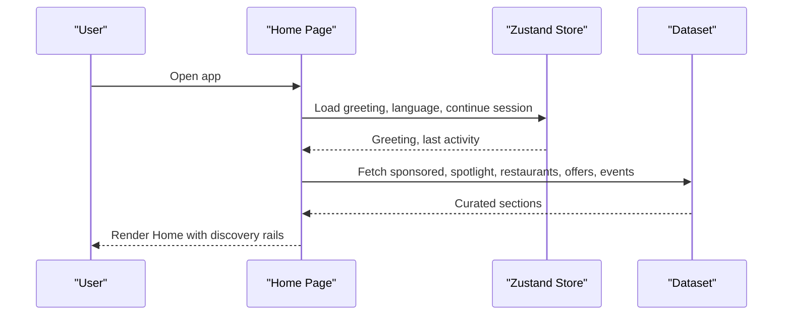

**Diagram sources**
- [Pujo_Sahayak_Master_Project_Context.md:160-284](file://Pujo_Sahayak_Master_Project_Context.md#L160-L284)
- [Pujo_Sahayak_Master_Project_Context.md:286-318](file://Pujo_Sahayak_Master_Project_Context.md#L286-L318)
- [tasks/plan.md:19-39](file://tasks/plan.md#L19-L39)

**Section sources**
- [Pujo_Sahayak_Master_Project_Context.md:160-284](file://Pujo_Sahayak_Master_Project_Context.md#L160-L284)
- [Pujo_Sahayak_Master_Project_Context.md:286-318](file://Pujo_Sahayak_Master_Project_Context.md#L286-L318)

### Favorites Page
The Favorites page is more than a bookmark list. It includes saved pandals, places visited, and recommendations such as “You might like.” Recommendations should avoid absolute claims and can consider saved places, visited places, location, categories, preferences, and potentially AI suggestions.

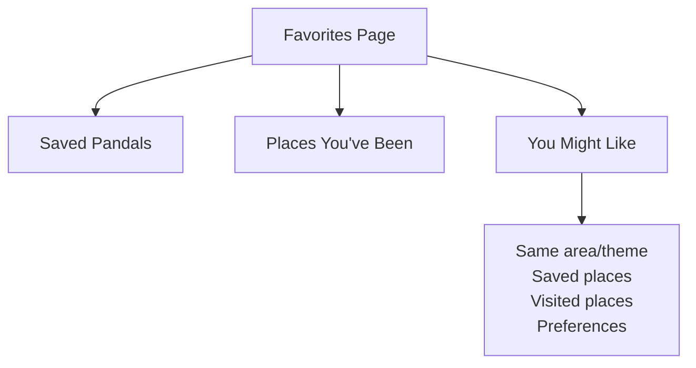

**Diagram sources**
- [Pujo_Sahayak_Master_Project_Context.md:320-351](file://Pujo_Sahayak_Master_Project_Context.md#L320-L351)
- [tasks/todo.md:47-48](file://tasks/todo.md#L47-L48)

**Section sources**
- [Pujo_Sahayak_Master_Project_Context.md:320-351](file://Pujo_Sahayak_Master_Project_Context.md#L320-L351)
- [tasks/todo.md:47-48](file://tasks/todo.md#L47-L48)

### Search Page
The Search experience covers the entire local ecosystem. It includes category shortcuts, trending pandals, popular nearby places, and live filtering against the dataset.

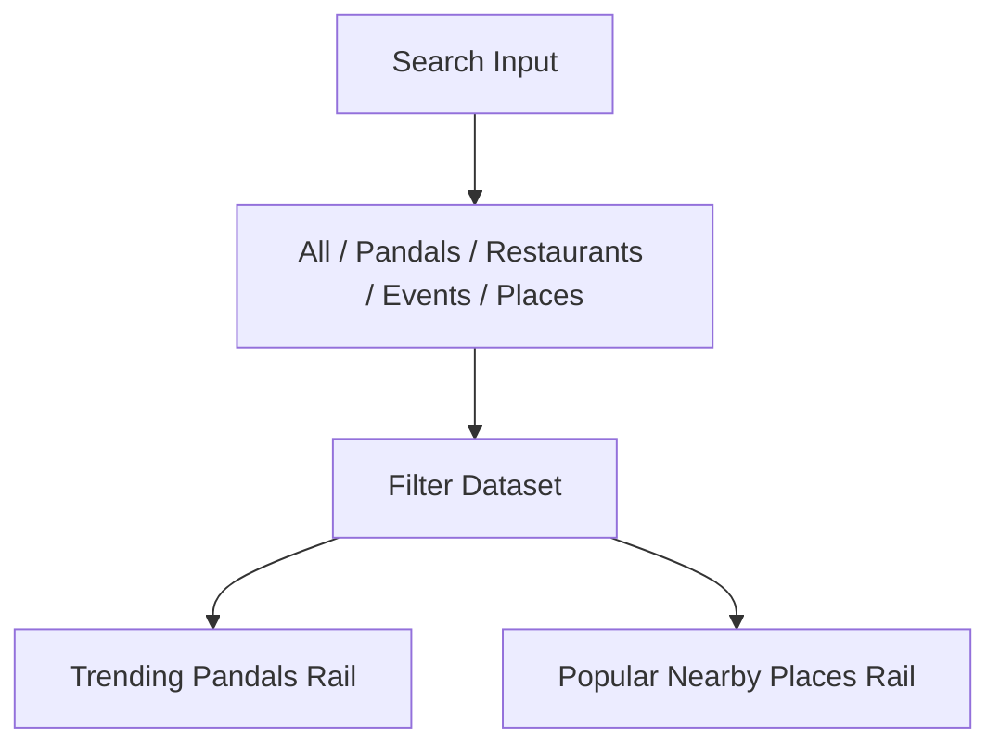

**Diagram sources**
- [Pujo_Sahayak_Master_Project_Context.md:447-493](file://Pujo_Sahayak_Master_Project_Context.md#L447-L493)
- [tasks/todo.md:42-43](file://tasks/todo.md#L42-L43)

**Section sources**
- [Pujo_Sahayak_Master_Project_Context.md:447-493](file://Pujo_Sahayak_Master_Project_Context.md#L447-L493)
- [tasks/todo.md:42-43](file://tasks/todo.md#L42-L43)

### Categories Page
The Categories page is a structured discovery hub grouped into Places, Transport & Services, and Utilities. It also includes a purple “Ask Maya” call-to-action.

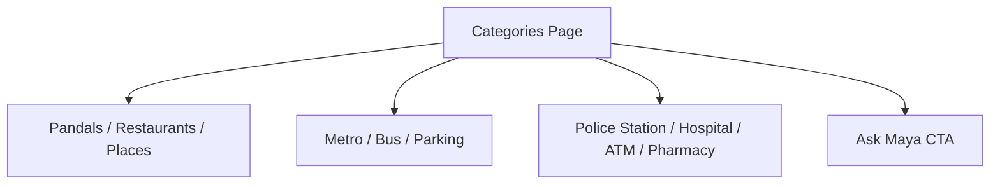

**Diagram sources**
- [Pujo_Sahayak_Master_Project_Context.md:495-556](file://Pujo_Sahayak_Master_Project_Context.md#L495-L556)
- [tasks/todo.md:42-43](file://tasks/todo.md#L42-L43)

**Section sources**
- [Pujo_Sahayak_Master_Project_Context.md:495-556](file://Pujo_Sahayak_Master_Project_Context.md#L495-L556)
- [tasks/todo.md:42-43](file://tasks/todo.md#L42-L43)

### Meets Page
The Meets page supports social discovery around shared interests and plans. It lists existing meetups and allows creating new ones. The tone is activity-based social discovery, not dating.

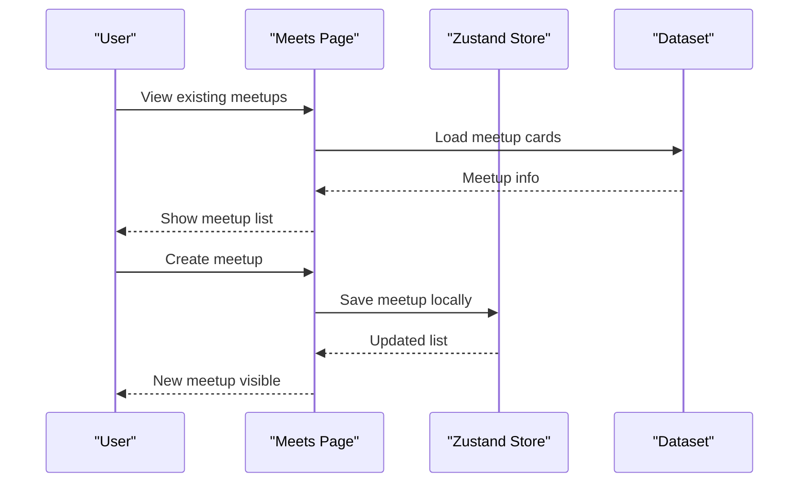

**Diagram sources**
- [Pujo_Sahayak_Master_Project_Context.md:664-771](file://Pujo_Sahayak_Master_Project_Context.md#L664-L771)
- [tasks/todo.md:53-54](file://tasks/todo.md#L53-L54)

**Section sources**
- [Pujo_Sahayak_Master_Project_Context.md:664-771](file://Pujo_Sahayak_Master_Project_Context.md#L664-L771)
- [tasks/todo.md:53-54](file://tasks/todo.md#L53-L54)

### Maya Assistant
Maya is the AI assistant. She is not a generic chatbot; she understands application data and context. She can explain pandal themes, symbolism, nearby services, planning help, and safety information. Answers should be grounded in the dataset and never hallucinated.

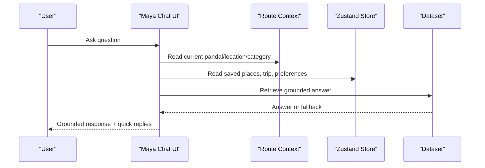

**Diagram sources**
- [Pujo_Sahayak_Master_Project_Context.md:558-662](file://Pujo_Sahayak_Master_Project_Context.md#L558-L662)
- [tasks/todo.md:36-40](file://tasks/todo.md#L36-L40)

**Section sources**
- [Pujo_Sahayak_Master_Project_Context.md:558-662](file://Pujo_Sahayak_Master_Project_Context.md#L558-L662)
- [tasks/todo.md:36-40](file://tasks/todo.md#L36-L40)

### Pandal Detail Page
The Pandal Detail page is a rich content page with hero image, save/bookmark, rating, reviews, distance, crowd level, open-till time, actions, location/metro/facilities/safety, about and theme story, “Ask Maya about this pandal,” what others say, top clicks, post your photos, similar places, nearby restaurants, and related meetups.

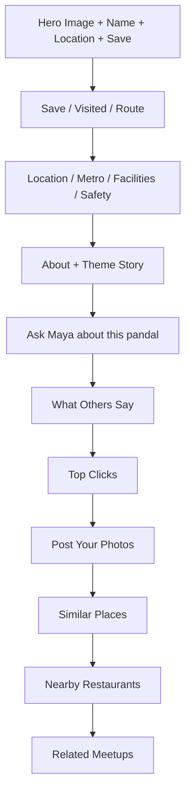

**Diagram sources**
- [Pujo_Sahayak_Master_Project_Context.md:775-800](file://Pujo_Sahayak_Master_Project_Context.md#L775-L800)
- [tasks/todo.md:29-30](file://tasks/todo.md#L29-L30)

**Section sources**
- [Pujo_Sahayak_Master_Project_Context.md:775-800](file://Pujo_Sahayak_Master_Project_Context.md#L775-L800)
- [tasks/todo.md:29-30](file://tasks/todo.md#L29-L30)

### Puja Planner
The Puja Planner supports multi-day itineraries across Panchami to Dashami. A plan can contain pandals, restaurants, events, attractions, transportation segments, and approximate timings. AI-assisted planning should present suggestions, not guaranteed optimal routes.

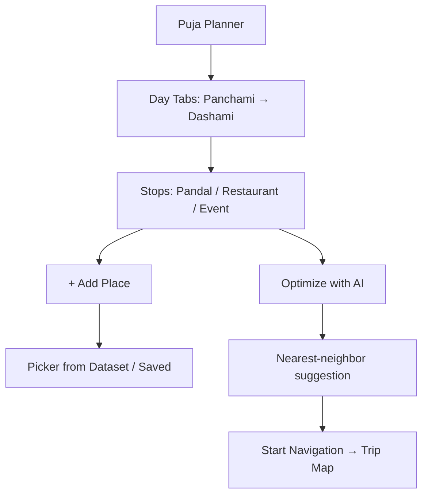

**Diagram sources**
- [Pujo_Sahayak_Master_Project_Context.md:353-443](file://Pujo_Sahayak_Master_Project_Context.md#L353-L443)
- [tasks/todo.md:50-51](file://tasks/todo.md#L50-L51)

**Section sources**
- [Pujo_Sahayak_Master_Project_Context.md:353-443](file://Pujo_Sahayak_Master_Project_Context.md#L353-L443)
- [tasks/todo.md:50-51](file://tasks/todo.md#L50-L51)

## Dependency Analysis
The design system depends on a small set of core technologies and data structures. The dependencies are intentionally kept minimal to maintain a bespoke UI and avoid generic SaaS styling.

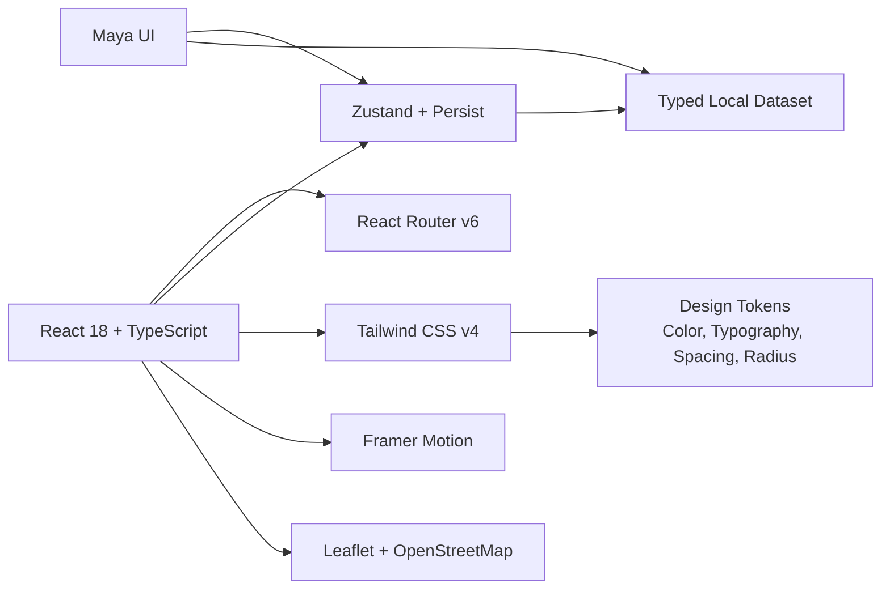

**Diagram sources**
- [tasks/plan.md:9-18](file://tasks/plan.md#L9-L18)
- [tasks/todo.md:10-14](file://tasks/todo.md#L10-L14)

**Section sources**
- [tasks/plan.md:9-18](file://tasks/plan.md#L9-L18)
- [tasks/todo.md:10-14](file://tasks/todo.md#L10-L14)

## Performance Considerations
The project targets mobile devices and PWA behavior. Key performance considerations include:

- Mobile-first responsive layout with adaptive desktop adaptation later.
- Offline shell via `vite-plugin-pwa`.
- Local demo dataset to avoid heavy network calls during development.
- Framer Motion animations that honor reduced-motion settings.
- Leaflet maps using OpenStreetMap tiles instead of Google Maps keys.
- Images using curated gradients and placeholders until real photography is available.
- Build verification with clean builds and Lighthouse PWA installability checks.

[No sources needed since this section provides general guidance]

## Troubleshooting Guide
Common issues and their mitigation strategies are documented in the implementation plan:

- Scope fatigue due to 21 screens: mitigated by vertical slices and keeping the todo list alive between sessions.
- Mockup fidelity versus improved polish: IA locked to mockups; visual polish guided by tokens; review screenshots per checkpoint.
- Maya expectations: explicitly local retrieval demo; architecture keeps a clean swap-in point for a real LLM API.
- Offline image availability: gradient/placeholder fallbacks; layout never breaks without images.
- Bengali text rendering: Google Fonts with system fallbacks.

**Section sources**
- [tasks/plan.md:71-86](file://tasks/plan.md#L71-L86)

## Conclusion
The Puja Sahayak UI/UX design system is a mobile-first, bespoke design system built on Tailwind CSS v4, React, TypeScript, and supporting libraries. It emphasizes a continuous user journey, contextual AI assistance, and inclusive accessibility. The navigation is intentionally simple, the component library is custom, and the data model is grounded in a local demo dataset. As implementation proceeds, the design system will evolve alongside the phased build plan, maintaining consistency across screens, orientations, and device capabilities.

[No sources needed since this section summarizes without analyzing specific files]

## Appendices

### Design Tokens Summary
- Colors: ivory surfaces, vermilion primary, charcoal ink, muted gold, dark imagery.
- Typography: English sans-serif base; Bengali serif accent using Noto Serif Bengali and Hind Sildar with system fallbacks.
- Spacing: Tailwind spacing scale applied consistently across components.
- Radius: Consistent border radius for cards, chips, and buttons.
- Imagery: Dark imagery and curated gradients; placeholder-safe layouts.

**Section sources**
- [tasks/plan.md:9-11](file://tasks/plan.md#L9-L11)
- [tasks/plan.md:16-17](file://tasks/plan.md#L16-L17)

### Accessibility Guidelines
- Honor reduced-motion settings in Framer Motion.
- Ensure sufficient color contrast for ivory, vermilion, charcoal, and gold tokens.
- Provide keyboard-accessible navigation for bottom nav and action rows.
- Use semantic HTML for headings, buttons, and links.
- Include alt text for images and meaningful labels for interactive elements.
- Support Bengali and English text rendering with appropriate fonts.

[No sources needed since this section provides general guidance]

### Responsive Breakpoints and Adaptive Layouts
- Mobile-first approach with bottom navigation optimized for touch.
- Desktop adaptation using max-width app frame and multi-column rails.
- Verify layout at small mobile widths and larger desktop widths.

**Section sources**
- [tasks/plan.md:60-61](file://tasks/plan.md#L60-L61)
- [tasks/todo.md:74-75](file://tasks/todo.md#L74-L75)