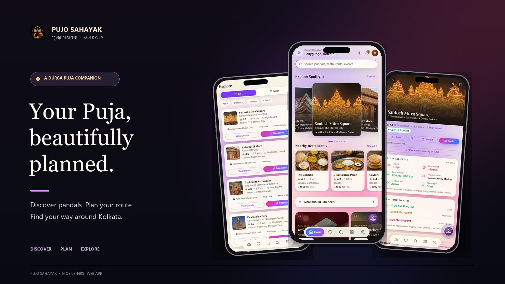
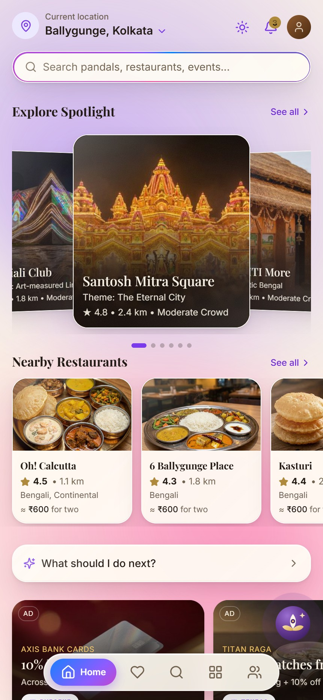
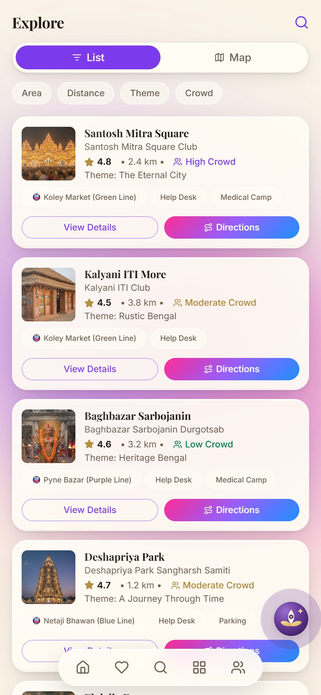
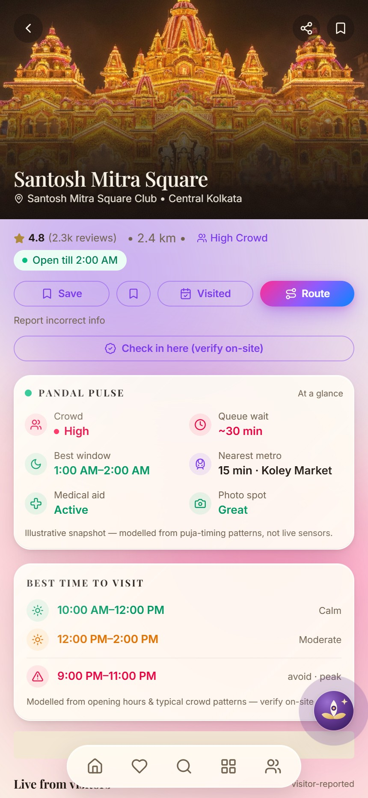

#  Pujo Sahayak · পূজা সহায়ক

**A mobile-first guide to discovering Durga Puja in Kolkata.** Explore pandals and food, shape an itinerary, find your way around, and reach practical safety tools from one installable web app.

<p>
  
  
  
  
</p>

<p align="center">
  <a href="assets/screens/readme/pujo-sahayak-showcase.jpg"></a>
</p>

> **Project status:** This is a demo/prototype. Some ratings, crowd levels, opening times, reviews, event and meetup details, distances, and commerce information are sample data. Backend-dependent features need a configured Supabase project. Check the labels in the app before relying on time-sensitive information.

## Inside the app

Fresh captures from the running app at a 430 px mobile viewport. Select any screen to open it at full size.

<p align="center">
  <a href="assets/screens/readme/home.jpg"></a>
  &nbsp;&nbsp;
  <a href="assets/screens/readme/explore.jpg"></a>
  &nbsp;&nbsp;
  <a href="assets/screens/readme/pandal.jpg"></a>
</p>

<p align="center"><sub><b>Home</b> · Discover places &nbsp;&nbsp; <b>Explore</b> · Filter and compare &nbsp;&nbsp; <b>Pandal detail</b> · Plan a visit</sub></p>

## What you can do

- **Discover:** browse pandals and restaurants, filter places, and view them on a map.
- **Plan:** organize stops by Puja day, review approximate travel legs, and export or share an itinerary.
- **Get oriented:** view Kolkata Metro information, place details, and day-of weather forecasts.
- **Stay prepared:** open the safety hub, manage trusted contacts, share a location through the device share sheet, and find emergency calling options.
- **Keep your own record:** save places and track local check-ins, badges, and Puja memories.
- **Ask Maya:** use the in-app guide, which can run with its offline response layer; an optional language-model integration is also available.
- **Choose your experience:** switch between English, বাংলা, and हिन्दी, and select light or dark appearance.

Some community and commerce screens are demos or depend on backend/provider setup. The app labels sample or modeled information; it does not provide guaranteed live crowd, traffic, emergency dispatch, or payment services.

## Run locally

### Requirements

- Node.js and npm

### Start the app

```bash
git clone https://github.com/SaptajitSaha/pujo-sahayak.git
cd pujo-sahayak
npm install
npm run dev
```

Open the local URL printed by Vite. The app can be explored without Supabase; backend-connected features remain unavailable until configured.

### Environment variables

Copy `.env.example` to `.env.local` and add only the values you need:

```bash
VITE_SUPABASE_URL=https://your-project.supabase.co
VITE_SUPABASE_ANON_KEY=your-supabase-anon-key
```

Optional integrations:

| Variable | Purpose |
| --- | --- |
| `VITE_FLAG_<FEATURE>` | Build-time feature defaults; see `src/config/features.ts` |
| `VITE_OPENAI_KEY` | Optional Maya model integration |
| `VITE_OPENAI_MODEL` | Optional model override |
| `VITE_GOOGLE_MAPS_KEY` | Use Google Maps in the location pin picker instead of the default OpenStreetMap map |

Create `.env.local` for local development and never commit it. `VITE_*` values are included in the client-side app bundle; do not put a private production API key in the frontend. Use a server-side proxy for production model access. Keep Supabase service-role and scheduler secrets server-side; the browser should use only the anon key.

## Supabase setup

Supabase is optional. To enable its Auth, database, and community integrations:

1. Create a Supabase project and set `VITE_SUPABASE_URL` and `VITE_SUPABASE_ANON_KEY` in `.env.local`.
2. Apply the SQL migrations in order: `supabase/migrations/001_initial_schema.sql`, then `supabase/migrations/002_moderation_and_commerce_boundaries.sql`.
3. Configure any required Edge Function secrets in Supabase. Never expose service-role or scheduler secrets in the client.
4. Set feature defaults as needed and restart the Vite server after changing environment values.

The marketplace payment adapter is a mock and does not move real money. Authority feeds and other provider-dependent features require a real provider configuration; do not treat demo content as a live service.

## Commands

| Command | Description |
| --- | --- |
| `npm run dev` | Start the Vite development server |
| `npm test` | Run the Vitest suite |
| `npm run build` | Type-check and create the production build |
| `npm run preview` | Serve the production build locally |

## Project layout

```text
src/
  components/   Shared UI and feature components
  config/       Feature defaults and route guards
  data/         Types and demo content
  i18n/         Translation and locale helpers
  lib/          App utilities and domain logic
  pages/        Route-level screens
  services/     Supabase and provider integrations
  store/        Persisted client state
  maya/         Maya assistant layers
supabase/
  functions/    Edge Functions
  migrations/   Database schema and policy migrations
assets/screens/ App screenshots used in this README
```

## Stack

React 18 · TypeScript · Vite · Tailwind CSS 4 · Zustand · TanStack Query · React Router · Framer Motion · Leaflet/OpenStreetMap · Supabase (optional) · `vite-plugin-pwa`

## License

Private project. All rights reserved.
