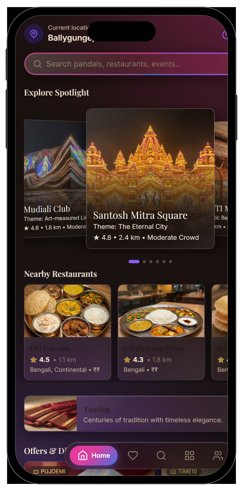
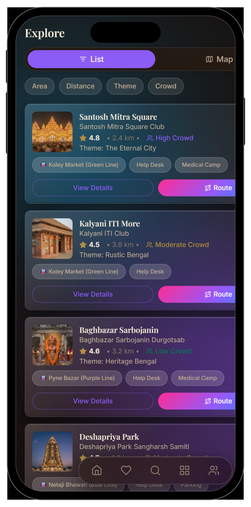
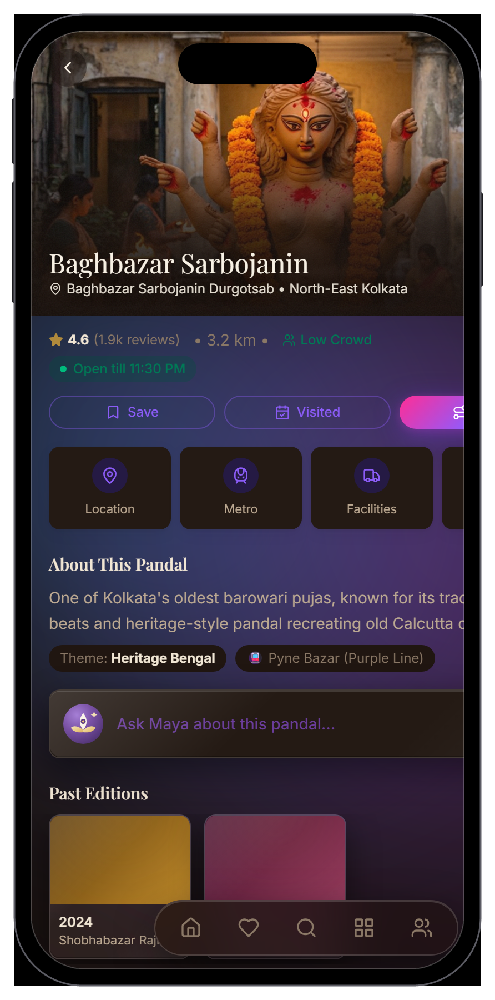
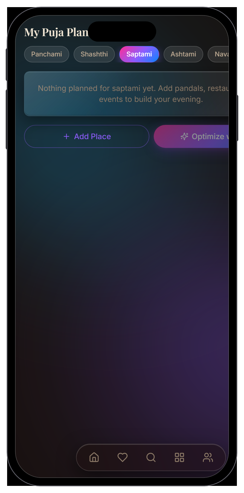
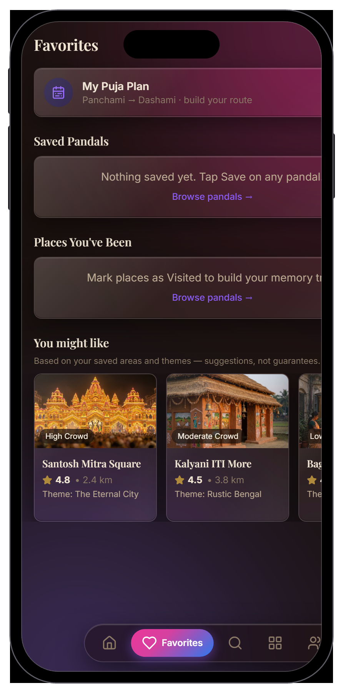
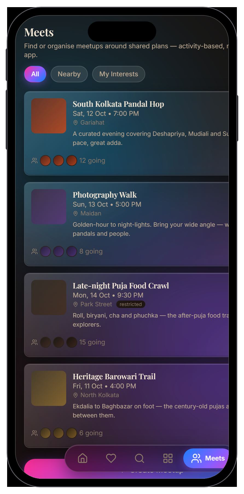
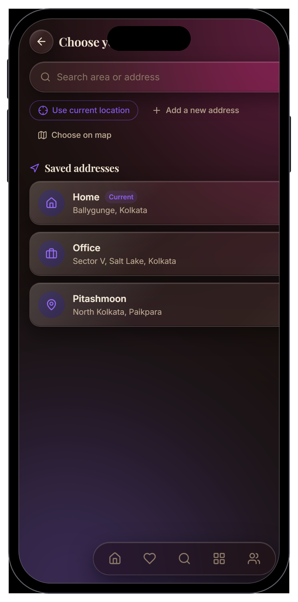
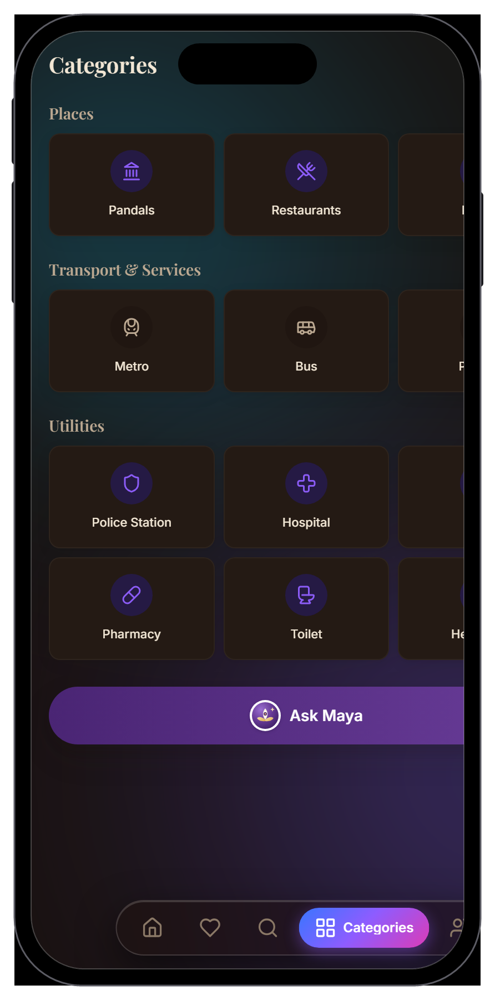
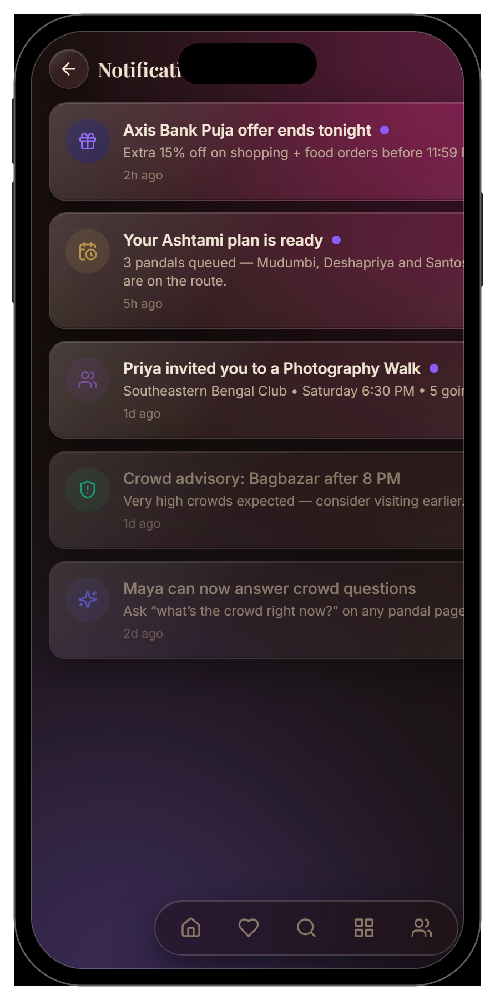

<div align="center">


# Pujo Sahayak · পূজা সহায়ক

**Your companion for Durga Puja in Kolkata — pandals, food, routes, safety and a
guiding light, all in your pocket.**

A mobile-first, installable **PWA** built with React + Vite. Offline-friendly,
trilingual, and grounded in *real* Kolkata pandals and restaurants.

[](https://react.dev)
[](https://vitejs.dev)
[](https://www.typescriptlang.org)
[](https://tailwindcss.com)
[](https://vite-pwa-org.netlify.app)

</div>

---

<table align="center">
  <tr>
    <td align="center"></td>
    <td align="center"></td>
    <td align="center"></td>
  </tr>
  <tr>
    <td align="center"><sub><b>Home</b> — nearby spotlight & rails</sub></td>
    <td align="center"><sub><b>Explore</b> — filter, list & map</sub></td>
    <td align="center"><sub><b>Pandal</b> — theme, crowd, metro</sub></td>
  </tr>
</table>

---

## ✨ What it does

- **Pandal & restaurant discovery** — curated, real Kolkata spots with themes,
  live crowd levels, ratings, distances and nearest metro stations.
- **Maya, your guide-light** — an in-app assistant for "which pandal should I
  not miss?", food recs and day-by-day planning.
- **Trip planner & route maps** — build an itinerary across the days of Puja and
  see it on an interactive map.
- **Day-of weather** — real Open-Meteo forecasts (no key, no tracking) on the
  planner and the tithi timeline; cached for offline and clearly flagged when
  stale — never a fabricated forecast.
- **Pandal-hopping scorecard** — GPS-verified on-site check-ins build your
  streak, badges and pandals-seen, all computed on your device. No location,
  no check-in.
- **Meetups** — create and join plans so no one wanders the crowds alone.
- **Safety** — a dedicated hub with a missing-person flow and help-desk / medical
  camp info surfaced on every pandal card.
- **Real location, honestly handled** — device geolocation with Nominatim
  reverse-geocoding for addresses; graceful coordinate-only fallback when
  offline or permission is denied. It never invents an address.
- **Trilingual chrome** — English · বাংলা · हिन्दी, plus light/dark themes.
- **Installable & offline-friendly** — service worker, app shell, and a
  reduced-motion mode that respects your system preference.

## 📱 Screens

<table>
  <tr>
    <td align="center"><br /><sub><b>Planner</b></sub></td>
    <td align="center"><br /><sub><b>Favorites</b></sub></td>
    <td align="center"><br /><sub><b>Meetups</b></sub></td>
    <td align="center"><br /><sub><b>Location picker</b></sub></td>
  </tr>
  <tr>
    <td align="center"><br /><sub><b>Categories</b></sub></td>
    <td align="center"><br /><sub><b>Notifications</b></sub></td>
    <td colspan="2" align="center" valign="middle"><sub>…and more: <b>Maya</b> assistant, <b>Trip map</b>,
    <b>Safety</b>, <b>Missing person</b>, <b>Settings</b>, <b>Beyond Puja</b>.</sub></td>
  </tr>
</table>

## 🧱 Tech stack

| Concern | Choice |
| --- | --- |
| Framework | React 18 + TypeScript |
| Build / dev | Vite 6 (code-split routes, lazy loading) |
| Styling | Tailwind CSS v4 (`@theme` design tokens) |
| State | Zustand 5 with `persist` (versioned migrations) |
| Motion | Framer Motion 11 (scroll reveals, fluid gradients) |
| Maps | Leaflet + OpenStreetMap · optional Google Maps (key-gated) |
| Icons | lucide-react |
| Delivery | `vite-plugin-pwa` — installable, offline app shell |
| Geocoding | Browser Geolocation + Nominatim (OSM) reverse geocode |

## 🚀 Getting started

```bash
# 1. Install dependencies
npm install

# 2. Start the dev server
npm run dev

# 3. Production build + local preview
npm run build
npm run preview
```

Then open the printed local URL (mobile viewport recommended) — or run a Lighthouse
audit to see the PWA score.

### Optional: Google Maps for the pin picker

By default the drop-a-pin address picker uses the free **Leaflet + OpenStreetMap**
tiles — no key, no billing, works out of the box. If you have a Google Maps key and
prefer it for that one screen, add a `.env.local`:

```bash
# .env.local  (never committed — see .env.example)
VITE_GOOGLE_MAPS_KEY=your_key_here
```

The app automatically switches the pin picker to Google Maps when the key is
present, and falls back to OSM when it isn't. Trip/Explore maps always stay on
Leaflet.

## 🌿 Design notes

- **Ambient background** — two full-height gradient blobs drift on mirrored
  vertical sweeps behind a glassmorphic UI.
- **Fluid brand gradient** — a purple → pink → blue ramp animates across the
  active nav pill and primary CTAs.
- **Motion with a brake** — every scroll reveal, count-up and rail honours
  `prefers-reduced-motion` (and an in-app toggle), rendering content instantly.

## 📜 License

Private project — all rights reserved.
